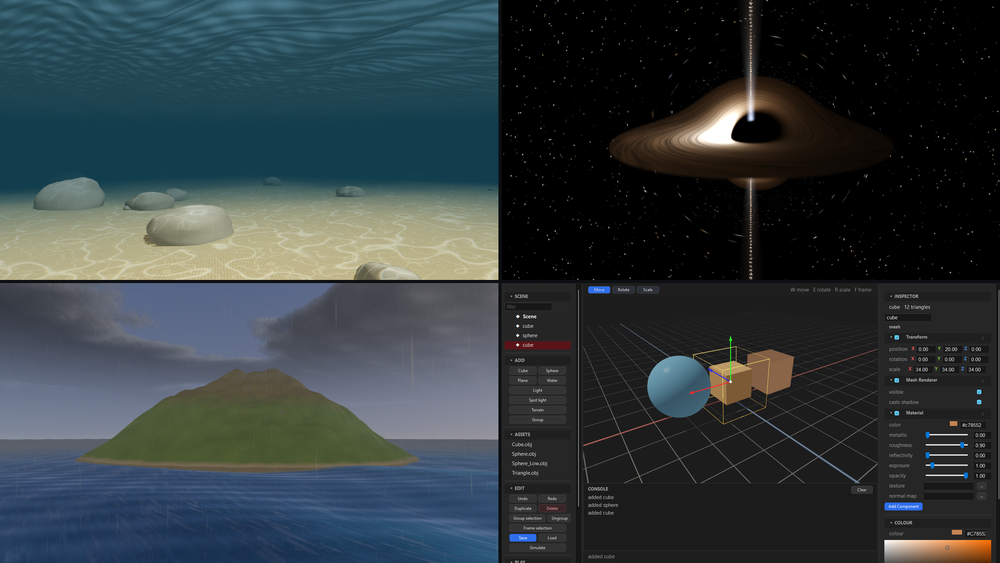
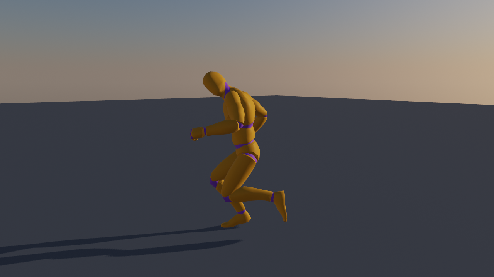

# ae3d

[](https://github.com/aether-lang-dev/ae3d/actions/workflows/ci.yml)
[](LICENSE)

**A 3D game engine written in [Aether](https://github.com/aether-lang-dev/aether), built to be driven, and checked, by programs.**

Vulkan and OpenGL behind one scene API, a physics engine of its own, an animation pipeline with retargeting and IK, crowds of half a million, multiplayer, a Blender pipeline and a scene editor. A program, a test or an AI agent can build a scene through a control channel, read back the frame it drew, and hold it to a number.



<sub>Unedited Vulkan frames: `examples/caustics.ae`, `examples/black_hole.ae`, `examples/smooth_terrain.ae` under `AE3D_WEATHER=storm`, and the editor.</sub>

ae3d is the next generation of [Gopher3D](https://github.com/nicolas-maman/gopher3D), the same author's Go engine, rebuilt in Aether and taken much further.

## Why ae3d

- **Every claim is a number.** Features ship with a test that measures them on the frame or the simulation, and scenes are verified from a sweep of camera positions, not from one still. Each page of the docs gives the measurement behind what it claims ([testing](docs/testing.md)).
- **Programs drive it.** `AE3D_AGENT=port` opens a JSON channel: change the scene, hold a frame, read its pixels, trace a model from its Blender object to the pixels it landed on ([agent channel](docs/agent.md)).
- **One language, top to bottom.** The loop, the renderers, the physics and the crowd's kernels are Aether. The C that remains is listed with one reason each ([native/README.md](native/README.md)).
- **Two renderers, one interface.** Vulkan by default and OpenGL at parity; one test draws the same scene through both and holds them to within 0.7% of channels. DirectX 12 and Metal are next on the same interface.

## What's inside

**Rendering** ([docs](docs/rendering.md))
- Physically based materials, sixteen lights a frame from any number, normal maps, texel-snapped shadow maps.
- Global illumination: DDGI probes traced on the GPU where it traces, the sky's own light elsewhere.
- Ray-traced shadows and ambient occlusion through Vulkan ray queries, screen-space reflections, SSAO.
- MSAA, TAA, DLSS and a spatial upscaler, HDR with bloom and ACES, depth of field, environment maps from HDR and EXR files.
- A sky by the hour with volumetric clouds, weather (rain, snow, dust, storm), and a Gerstner sea with caustics.

**Animation** ([docs](docs/animation-pipeline.md))
- One pose per figure per frame, one writer: games set a speed or a state, never a bone.
- Rigs from UE5, Rigify or Mixamo naming on one humanoid layout; clips retargeted between bodies, and motion capture read from BVH (100STYLE) with its feet kept.
- A state graph, 1D and 2D blend spaces synced on footfalls, inertialized transitions, aim offsets, masked and additive layers, motion matching, and a mover that starts, stops and turns on the spot in steps.
- IK with knees and elbows held to their limits, FABRIK chains, whole-body reach, an aim spread up the spine with both hands on a rifle, and feet on any ground: soles traced heel to toe on stairs and slopes, toes bent at the ball.
- Held to numbers on real people: from 1 to 8 m/s a planted toe slides under 1.5 mm and the feet carry the ground at the speed asked within 1%; on 0.2 m stairs and a 20° ramp no sole sinks 1 mm into the ground; a change of gait turns no joint 2% faster than the clips themselves do.



<sub>`tools/anim_showcase.ae`: Quaternius's Rigify mannequin (CC0) on its walk, jog and sprint blended by speed, the planted foot held by IK.</sub>

**Physics** ([docs](docs/physics.md))
- [aephysics](https://github.com/aether-lang-dev/aephysics), a rigid body engine on Box3D's design written in Aether: hulls, meshes, every joint, ragdolls that wear a skinned figure, vehicles, continuous collision, a parallel step identical to the bit at any thread count.
- A character controller over kerbs, stairs and slopes: 10,000 random moves through the street end no deeper than the solver's 5 mm slop.
- Active ragdolls on any figure, struck and recovering ([natural motion](docs/motion.md)).

**Crowds and navigation** ([docs](docs/crowds.md))
- Walk cycles baked into pose banks and every instance posed on the GPU from its own phase, in three tiers by distance down to lit impostors, sorted and drawn indirect on the device.
- Half a million animated zombies at 79 fps, steered by a flow field over the ground.

**Multiplayer** ([docs](docs/networking.md))
- UDP with a reliable ordered channel of its own, TCP, or loopback with simulated latency, jitter and loss.
- Snapshots quantised and sent as changes against what each client acknowledged, only what is near each client or in its view, within its budget of bytes.
- Players predicted and reconciled, a horde simulated on every peer, and the editor playing a scene as a host and its clients.

**Tools and assets**
- A scene editor in the Unity mould: objects as their components, gizmos, terrain sculpting, Simulate, and Play as a host with clients ([editor](docs/editor.md)).
- A Blender pipeline whose builds are critiqued (texel density, planted feet, lit windows) and held to a frame budget ([pipeline](docs/pipeline.md)).
- glTF 2.0 with skins, animations, data URIs and sparse accessors; OBJ; OpenEXR; 3D audio with buses and ducking ([audio](docs/audio.md)); distance-field text for game UI ([UI](docs/ui.md)).

## Quick start

You need the [Aether toolchain](https://github.com/aether-lang-dev/aether) (`ae`, `aetherc`) on `PATH`, a C compiler, GLFW 3, zlib, `pkg-config` and the Vulkan headers. The Vulkan loader is opened at run time, so a Vulkan driver is optional.

```bash
brew install glfw molten-vk vulkan-loader                        # macOS
sudo apt install libglfw3-dev libvulkan-dev mesa-vulkan-drivers  # Debian/Ubuntu
pacman -S mingw-w64-ucrt-x86_64-{gcc,glfw,zlib,pkgconf,vulkan-headers,vulkan-loader}  # Windows, MSYS2 UCRT64
```

```bash
git clone --recursive https://github.com/aether-lang-dev/ae3d.git && cd ae3d
ae run examples/spinning_cube.ae                 # build and run, as any Aether project
```

`build.sh` builds a program against the engine as one shared library, which is what the editor and anything that loads scripts need:

```bash
./build.sh examples/street_drive.ae && ./build/street_drive      # W/S A/D, space, shift; drives itself if left alone
./build.sh tools/anim_showcase.ae && ./build/anim_showcase       # the animation pipeline on seven people
./build.sh examples/zombie_city.ae && AE3D_CROWD=100000 ./build/zombie_city
AE3D_API=opengl ./build/zombie_city                              # the other renderer
```

Every program reads the same environment: `AE3D_FRAMES=n` stops after `n` frames, `AE3D_HIDDEN=1` runs without a window, `AE3D_SNAPSHOT=frame.png` saves the last frame, and `AE3D_PERF=1` prints the frame's cost by stage. The full list and the build's options are in [Building](docs/building.md).

## A first program

A program reads the way a Unity or Gopher3D game does: game objects in a scene, scripts on them with Unity's phases under Unity's names, and the engine calling the phases.

```aether
import ae3d.core
import ae3d.engine
import ae3d.behaviour
import ae3d.loader

struct Spinner { pitch: float, yaw: float }        // the script's own state

start(state: ptr, go: *GameObject) {               // once, on its first frame
    cam = engine.engine_camera(engine.of(go))
    core.camera_look_at(cam, behaviour.object_position(go))
}

update(state: ptr, go: *GameObject, delta: float) { // every frame
    spin = state as *Spinner
    core.model_rotate(behaviour.object_model(go), spin.pitch * delta, spin.yaw * delta, 0.0)
}

main() {
    e = engine.engine_new()
    cube = loader.cube(1.0)
    core.model_set_scale(cube, 20.0, 20.0, 20.0)
    spinner = Spinner { pitch: 18.0, yaw: 30.0 }
    object = engine.object(e, "Cube", cube)                     // a game object with a mesh
    engine.script(object, "Spinner", &spinner, start, update)   // AddComponent
    engine.engine_run(e)
    engine.engine_free(e)                                       // the scene and its models go with it
}
```

Each frame runs `fixed_update` as many times as the fixed step fits, then `update`, then `late_update` after the draw. Physics is one more component:

```aether
physics.attach(e)
physics.rigidbody(crate, physics.DYNAMIC)
physics.box_collider(crate, core.vec3(0.5, 0.5, 0.5), physics.material(0.6, 0.0))
```

And a figure on its gaits, its feet on the ground:

```aether
runner = figure.figure(e, "Runner", "people/runner.glb")
a = animator.attach(e, runner)                                // the figure's one writer from now on
move = animator.add_blend(a, "move")
walk = animator.take(a, "Walk_Loop", false)
sprint = animator.take(a, "Sprint_Loop", false)
animator.blend_add(a, move, walk, clips.speed(walk))          // each gait at its own measured speed
animator.blend_add(a, move, sprint, clips.speed(sprint))
animator.set_feet(a, ikrig.feet_new(animator.rig(a), runner))
animator.play(a, move, 0.0)
animator.set_param(a, move, speed)                            // every frame, from the game
```

How the loop, the behaviours, the renderers and the job pool fit together is in [Architecture](docs/architecture.md).

## Gallery

| | |
|---|---|
|  |  |
| **`street_drive`**: every building and kerb a collider of its own triangles, a car on suspension, drive and steering joints, and bystanders who are active ragdolls the car knocks down. 501 bodies; the physics takes 0.09 ms of a 144 fps frame. | **`caustics`**: the seabed under a Gerstner swell, the light refracted through the surface every frame. |
|  |  |
| **`physics`**: four of the physics engine's reference scenes, every body a game object. | **`gltf_crowd`**: a public glTF figure, its walk baked, a hundred thousand of it sorted on the device. |
|  |  |
| **`smooth_terrain`** under `AE3D_WEATHER=rain`, `storm`, `dust` or `snow`. | **`sand`**: a million grains you plough into a heap that slumps to its angle of repose. |
|  |  |
| **`voxel_world`**: 3.9 million voxels as 259,000 faces in one draw. | **`black_hole`**: Kerr geodesics traced per pixel, the shadow checked against √27 M ([the write-up](docs/black-hole.md)). |

## Examples

| | |
|---|---|
| `street_drive` | Drive the street, then press E and walk it first person on a character controller. |
| `zombie_city` | The street instanced into a city and a horde hunting the camera; `AE3D_CROWD` sets the count. |
| `net_walk`, `net_cars` | Multiplayer: `./build/net_walk` hosts, `AE3D_NET=join:127.0.0.1 ./build/net_walk` joins. |
| `gltf_crowd`, `gltf_viewer` | Any glTF figure as a horde, or on a floor playing one of its animations. |
| `physics` | The reference scenes: `AE3D_PHYSICS_SCENE=pyramid`, `pile`, `ragdolls` or `cloth`. |
| `tools/anim_showcase` | The animation pipeline on seven people: gaits, retargets, motion capture, a graph on a mover, stairs and a ramp, a rifle aimed with both hands, hit layers, feet and look IK; `AE3D_METRICS=1` measures what a player would see wrong. |
| `caustics`, `smooth_terrain`, `voxel_world`, `sand`, `black_hole` | Water, terrain, voxels, a million instances, curved space. |
| `lights`, `models`, `blender_pipeline`, `backend_switch`, `spinning_cube` | Materials and lights, OBJ, the Blender export, the two renderers, the smallest program. |

## The editor

`editor/` is a scene editor built on [aether-ui](https://github.com/aether-lang-dev/aether-ui). It has a hierarchy, an asset browser, an inspector drawn from what each component declares, a viewport with gizmos, a sculpting brush, a Simulate button that runs the physics and puts the scene back, and undo. Any program's scene opens in it:

```bash
git clone https://github.com/aether-lang-dev/aether-ui.git ../aether-ui
./editor/build_editor.sh && ./build/ae3d_editor
AE3D_SCENE_OUT=build/street.json ./build/street_drive && ./build/ae3d_editor build/street.json
```

## Testing

`./ci.sh` is the whole gate, and CI runs it on Linux, Windows and macOS. It type-checks every module, runs every suite and benchmark, drives every example hidden, critiques the demo scene on both renderers, and holds it to its recorded frame cost. Each suite in `tests/` is one program that prints its own verdict, so `./build.sh tests/test_anim_pipeline.ae && ./build/test_anim_pipeline` runs one on its own ([testing](docs/testing.md)).

## Repository layout

```
src/ae3d/     the engine, one module a directory: core, engine, behaviour, input, jobs,
              vulkan and vk*, gl, rendering, sky, weather, water, terrain, voxel,
              pose, clips, animator, ikrig, retarget, figure, motion, physics,
              crowd, horde, nav, net, audio, gltf, agent, scene, ...
native/       the C that remains, by role: platform/, dlss/
deps/         aephysics, the physics engine, as a submodule
examples/     runnable scenes            tests/       one program a suite
benchmarks/   per-frame cost, no window  tools/       the agent client, viewer, critique, showcases
scripts/      export, critique, perf     editor/      the scene editor
docs/         the documentation, docs/images/ its pictures
```

## Documentation

[Architecture](docs/architecture.md) ·
[Building](docs/building.md) ·
[Rendering](docs/rendering.md) ·
[Animation pipeline](docs/animation-pipeline.md) ·
[Animation](docs/animation.md) ·
[Physics](docs/physics.md) ·
[Natural motion](docs/motion.md) ·
[Crowds](docs/crowds.md) ·
[Networking](docs/networking.md) ·
[Pipeline](docs/pipeline.md) ·
[Agent channel](docs/agent.md) ·
[Audio](docs/audio.md) ·
[Editor](docs/editor.md) ·
[Game UI](docs/ui.md) ·
[Performance](docs/performance.md) ·
[Testing](docs/testing.md) ·
[Writing Aether](docs/writing-aether.md) ·
[Changelog](CHANGELOG.md)

## Roadmap

The engine is built toward an open-world game it has to carry: hordes of animated zombies, extreme weather, the best picture the hardware gives, and multiplayer ([#326](https://github.com/aether-lang-dev/ae3d/issues/326)). Underway:

- **Animation** ([#853](https://github.com/aether-lang-dev/ae3d/issues/853)): physical animation on a ragdoll with a weight per bone, ragdolls that get up into a matched clip, 2D blend spaces, and full-body IK, then the older motion code moved onto the pipeline.
- **DirectX 12 and Metal** ([#311](https://github.com/aether-lang-dev/ae3d/issues/311), [#312](https://github.com/aether-lang-dev/ae3d/issues/312)) beside Vulkan.
- **Prompt to scene** ([#416](https://github.com/aether-lang-dev/ae3d/issues/416)): the agent pipeline that builds a game's scenes and assets through the engine.

## Credits

ae3d continues [Gopher3D](https://github.com/nicolas-maman/gopher3D) (MIT), the same author's earlier Go engine. Its architecture, GLSL programs, material and lighting model and OBJ loader's behaviour carry over; the Go served as the reference and none of it was copied. Built with [GLFW](https://www.glfw.org/) and [Vulkan](https://www.vulkan.org/) (MoltenVK on macOS); the image decoders are Aether ports of [stb_image](https://github.com/nothings/stb)'s. The test figures are [Quaternius](https://quaternius.com)'s CC0 mannequins and animations. See [NOTICE](NOTICE) and [THIRD_PARTY_LICENSES.md](THIRD_PARTY_LICENSES.md).

## License

MIT. See [LICENSE](LICENSE).
