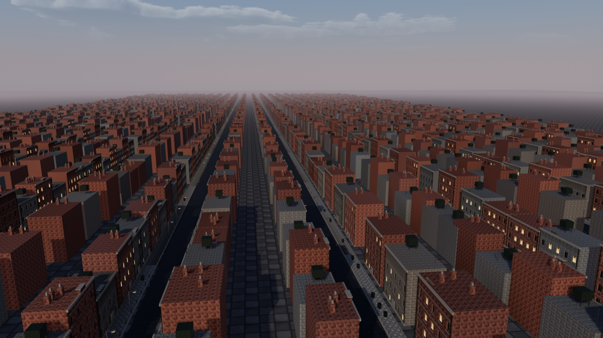

# Streaming a world

A world can be larger than what the engine holds. `ae3d.worldbake` cuts a
scene into a grid of cells, each with a cell file and a far stand-in.
`ae3d.stream` then loads the cells around the camera and the players and
lets them go once they are behind.



`examples/open_world` lays the street's block out as a city, scatters the
kit's props along every pavement, bakes it into cells of 44 m, and streams
it around a car driving the middle street. The near cells are the block as
modelled; past 150 m each is its stand-in, out to 1.4 km. With
`AE3D_CITY=16x12`, the city above, it is 192 blocks (1,344 by 528 m):
36,879 models, 5.2 million triangles as modelled and 2.5 million in the
stand-ins, in 372 cells. It is built a row of blocks at a time and each row
baked as it is built (`worldbake.begin`, `add`, `finish`), so the program
holds one row's models and not the city's. Building and baking take 34 s,
10 s of that the bake, at 274 MB peak resident (M1 Pro). The stream holds
about 60 cells and 220 MB at its peak.

## Baking

```
err = worldbake.bake(models, flags, 64.0, x0, z0, nx, nz, "build/world/")
```

A world too large to build whole is baked in batches:

```
b = worldbake.begin(64.0, x0, z0, nx, nz, "build/world/")
...for each part of the world
err = worldbake.add(b, models, flags)      // its cells written, the models the caller's to free
err = worldbake.finish(b)                  // world.json; b is freed
```

Each batch's models are bucketed by cell and its cells written at once. A
cell takes its models from one batch: a second batch with a model in a
cell already written is refused, since the file would lose the first
batch's. A texture's mean colour is read once for the whole bake.

Each model goes into the cell its bounds' centre stands over. `flags`, an
`int[]` beside the models or null, marks what each model is to the world
besides being drawn: `cellfile.FLAG_COLLIDER` or `cellfile.FLAG_NAV`. The
bake writes, under the directory:

- `cell_<x>_<z>.aecell` for every cell with a model in it. This is the
  cell's models as the renderer takes them: vertices, indices, instances,
  materials as JSON, world transforms and flags (see `ae3d.cellfile` for
  the layout).
- `cell_<x>_<z>.far.aecell`, the cell's stand-in, built as follows:
  - Every model drawn once is merged into one mesh. Instanced props are
    left out, since they are under a pixel at that distance.
  - The mesh is simplified to the coarsest cut of its cluster graph
    (`ae3d.clusterlod`). The vertices that two materials share are held,
    so no crack opens between them.
  - Each material's texture is replaced by the texture's mean colour (in
    linear light) baked into its diffuse. A stand-in holds no texture.
- `world.json`: the cell size, the origin, the size in cells, and each
  cell's two files.

`worldbake.last_stats()` reports what the bake wrote.

## Loading around a focus

```
st = stream.open("build/world/world.json")
stream.set_engine(st, e)
stream.set_radius(st, 160.0, 32.0)        // loaded within 160 m, let go past 192
stream.set_far(st, 600.0)                 // stand-ins out to 600 m
stream.set_budget(st, 4 * 1024 * 1024)    // bytes of geometry into the renderer a frame
...every frame
stream.focus_clear(st)
stream.focus(st, cam.position.x, cam.position.z)   // and one for each player a host keeps
stream.update(st)
```

Each cell moves through these states:

| State | What it means |
|---|---|
| unloaded | Nothing of it is held. |
| loading | A worker (`std.worker`) is reading its file, building its meshes, reading its materials and decoding the textures it names that no resident cell holds. |
| leaving | It was loading but is no longer wanted. It is freed the moment its load arrives. |
| loaded | Decoded, waiting for the frame's budget. |
| attaching | Its models are going to the renderer, as many each frame as the budget allows, and at least one, so no cell waits for ever. |
| resident | Every model is in. |

A cell is wanted when its square comes within the radius of any focus. It
is kept until it is past the radius plus the margin, so a focus pacing
along a border does not load and free the same cell over and over. Cells
are loaded nearest first, a few at a time (`set_loads`). A cell's stand-in
is loaded within the far radius and drawn only while the cell itself is
not resident.

The loop thread does only cheap work. A decoded model becomes the engine's
by being handed its mesh, and the decoded textures are offered to the
renderer (`core.offer_preloaded_image`), which takes them as the models
reach it.

### Colliders and walkers

```
physics.attach(e)
stream.set_physics(st, true, 0.6)                    // FLAG_COLLIDER models, friction 0.6
stream.set_nav(st, field, -0.3, 2.2, 0)              // FLAG_NAV models block the walkers' field
```

- **Colliders.** A `FLAG_COLLIDER` model's collision mesh is built on the
  worker during the cell's decode (`physics.mesh_of_mesh`). When the model
  attaches it becomes a static game object with a mesh collider, so the
  collider is in place from the moment the model is, and leaving destroys
  it. Instanced models are left out, since their copies are not one body.
- **Walkers.** A cell's `FLAG_NAV` models block the field when the cell
  becomes resident (`nav.flow_block_mesh`), and are unblocked just before
  it leaves (`nav.flow_unblock_mesh`). A cell's blockers let go open only
  what nothing else blocks: a neighbouring cell's walls and the game's own
  blocks stay (see "What blocks a cell" in [crowds.md](crowds.md)).

`event_count`, `event_kind` and `event_cell` report each cell that arrived
(`ARRIVED`, all its models in and its blockers placed) or is about to
leave (`LEFT`, reported before its models are freed). `cell_models` gives
the cell's models for anything else the game hangs on them. Call
`events_clear` once the events have been read.

### Driven across

`tests/test_stream_drive.ae` drives a 448 m world of 196 cells in a running
engine (Vulkan, M1 Pro, 640x360). A ball is pushed along at 30 m/s by the
engine's physics, rolling on the streamed ground tiles, and the stream
follows it. The drive runs twice: with every cell loaded first, then
streamed from a standing start.

- The ball's lowest point is 0.505 m in both: it rests on the ground the
  whole way, so every collider was in place before it arrived. With the
  streamed colliders switched off, it falls through within 128 frames.
- The 99th percentile frame is 9.41 ms streamed against 9.61 ms with
  everything loaded. The test holds streaming to adding under 8 ms.

### What it holds

`resident_bytes` and `peak_bytes` count what the cells' decodes made. A
cell's geometry counts from the moment it arrives until it is freed. Its
decoded textures count only until it is resident, when they become the
renderer's (or are let go, the renderer holding them already). `missing(st, metres)` counts the cells within
that distance of a focus that are not resident.

A load takes time. The radius should be the distance a cell must be ready
by, plus what the fastest focus covers while a cell loads. The test drives
at 30 m/s and allows a lead of 32 m.

### On the agent channel

`stream.cells` answers with every open stream: its grid, its radii, the
bytes it holds and its peak, how many loads are in flight, how many cells
within the radius are missing, and every cell that is not unloaded with its
state, its stand-in's state, its distance and how many times it has loaded.

## Textures

A renderer holds a texture while a model it draws uses a material that
names it, and lets it go with the last such model (`Material.renderer_users`).
A world streamed past therefore keeps only the near cells' textures in
memory, and a cell that comes back reads its textures again.
